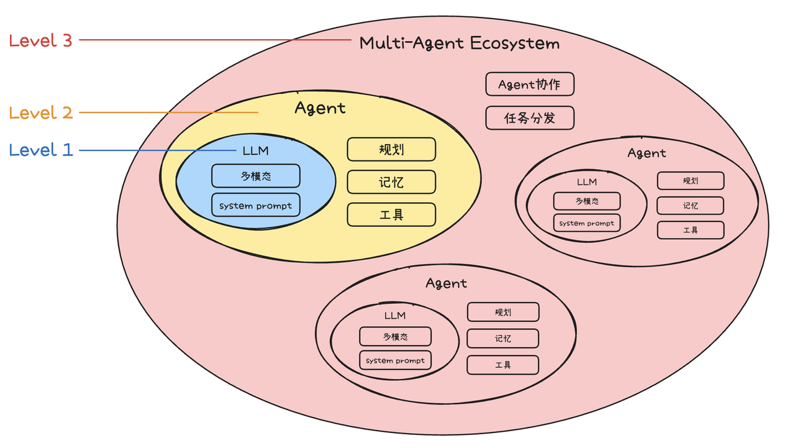
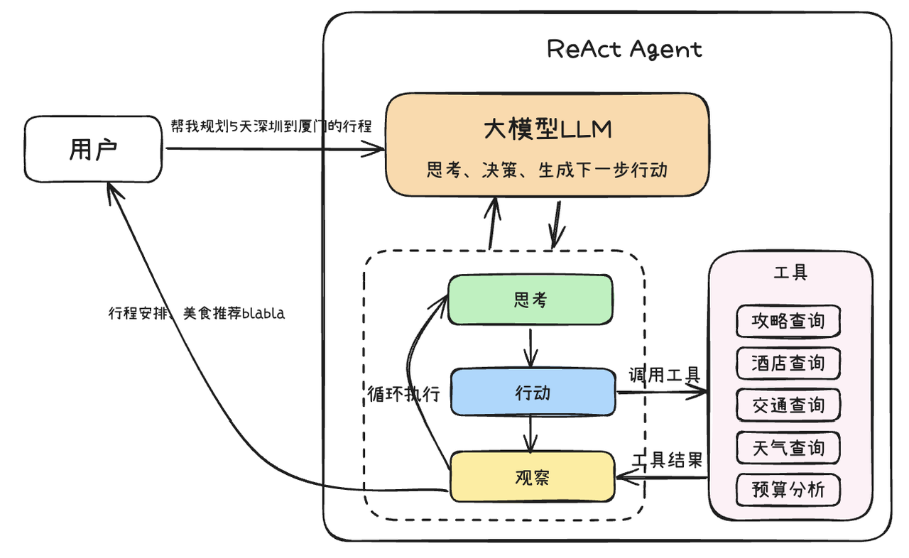
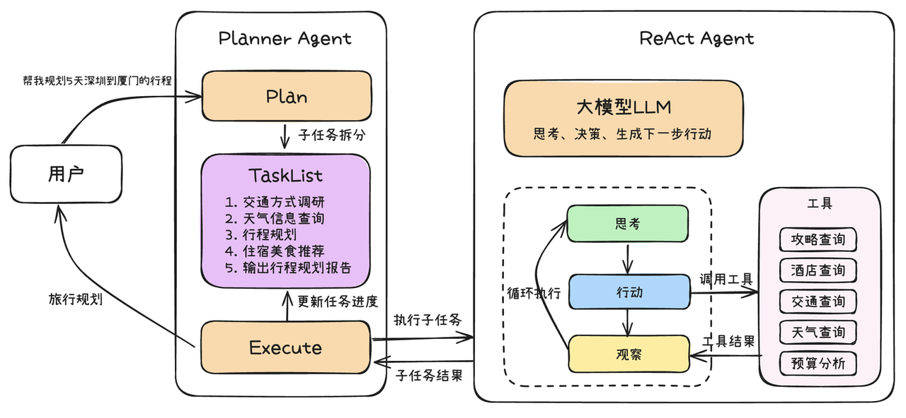
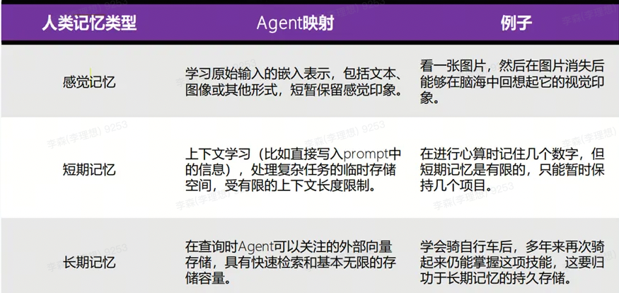
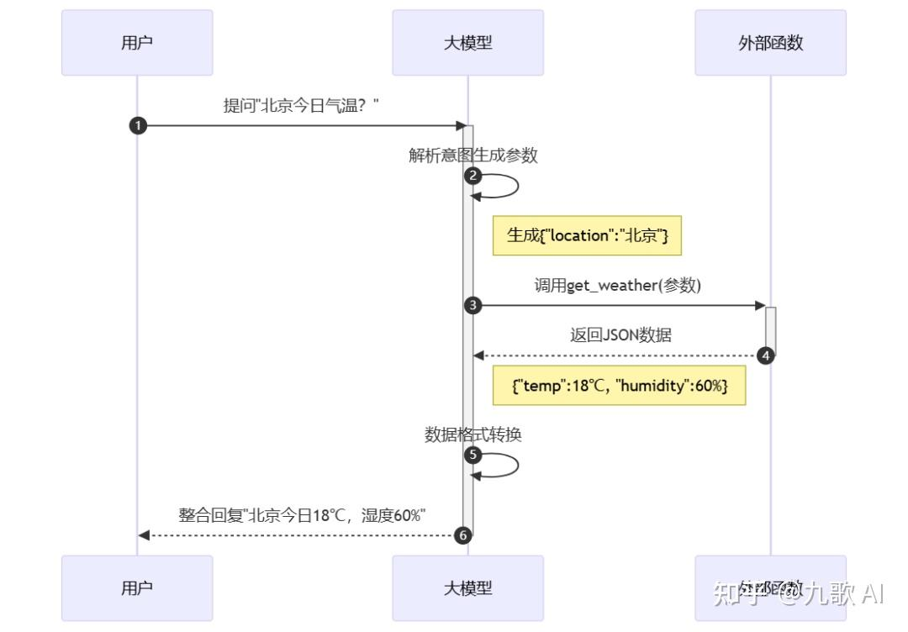
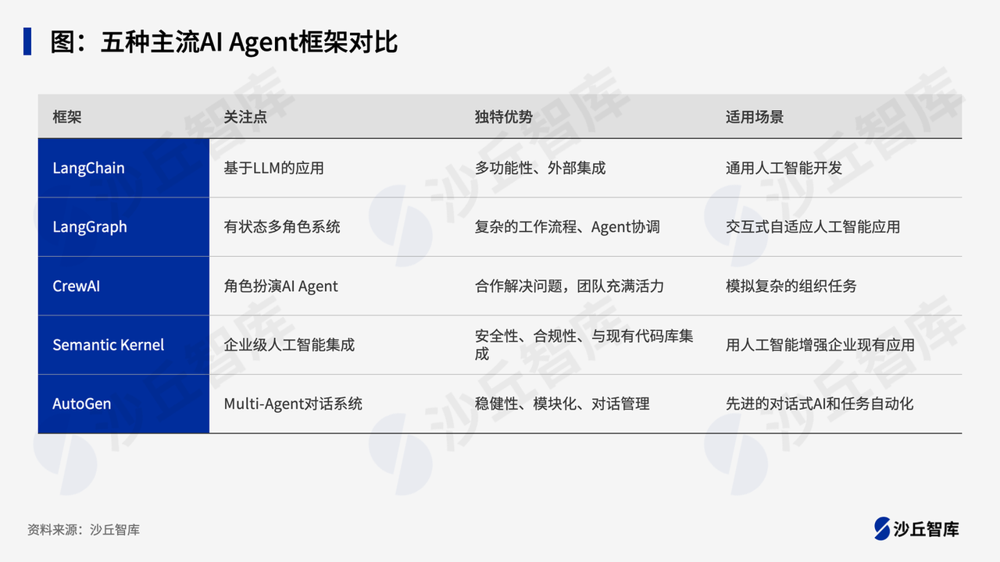

### 什么是AI Agent
AI Agent（也称人工智能代理）是一种能够感知环境、进行决策和执行动作的智能实体。智能体像人一样，它有记忆、有逻辑分析能力、有任务的拆解能力、问题的拆解能力和最后综合回来统一解决问题的能力。
Agent的能力依赖四大组件协同工作（基于"LLM+规划+记忆+工具"框架）： 

1. 大模型（LLM） ：作为“大脑”，负责语义理解与推理
2. 规划模块  
  - 任务拆解：将“策划营销活动”分解为“选品→定价→设计海报”
  - 动态优化：根据执行结果自动调整策略（如酒店满房时切换备选方案）  
3. 记忆系统  
  - 短期记忆 ：对话上下文管理（受限于Token长度）
  - 长期记忆 ：外接向量数据库存储历史经验（如用户习惯、业务规则）
4. 工具调用： 通过 Function Calling 以及 MCP协议 对接外部API

<!--more-->
AI Agent的开发范式演进可以分如下三个阶段，从简单到更丰富的应用形态。


- Level 1: LLM Agent
- Level 2: AI Agent
- Level 3: Multi AI Agent
  多Agent系统有以下几个核心优势：
  - 任务聚焦：单个智能体专注特定任务（如搜索或图表生成），比多工具选择更高效。
  - 独立优化：可单独改进单个智能体，不影响整体流程。
  - 问题拆解：将复杂问题拆分为可处理的子任务，由专业智能体处理。

### 规划模块  

#### 思维链（CoT）
思维链（Chain of Thought, CoT）是一种增强大型语言模型（LLM）处理复杂推理任务能力的关键技术。其核心在于引导模型在给出最终答案前，先生成一系列结构化的中间推理步骤——这如同模拟人类解决问题时的逐步思考过程。DeepSeek-R1等深度思考模型就是CoT应用场景。

#### ReAct
ReAct（Reasoning and Action）是一个框架，其概念来源于一篇论文，其核心思想，就是通过思维链的方式，引导模型将复杂问题进行拆分，一步一步地进行推理（Reasoning）和行动（Action），同时还引入了观察（Observation）环节，在每次执行（Action）之后，都会先观察（Observation）当前现状，然后再进行下一步的推理（Reason）。
ReAct这个框架，就是要让开发者一步步引导LLM进行推理，然后根据推理的结果，判断采取哪个行动。

CoT虽然增强了模型的推理能力，但其推理过程主要局限于模型内部知识，缺乏与外部世界的实时交互，这可能导致知识陈旧、产生幻觉或错误传播。ReAct（Reasoning and Action）框架通过将"推理"（Reasoning）与"行动"（Action）相结合，有效地解决了这一问题。其核心运作机制可以概括为思考（Thought）→ 行动（Action）→ 观察（Observation）的迭代循环：
- 思考 (Thought)：模型基于当前任务目标和已有的观察信息，进行逻辑推理和规划。它会分析问题，制定策略，并决定下一步需要执行什么动作（例如，调用哪个工具、查询什么信息）来达成目标或获取关键信息。
- 行动 (Action)：根据"思考"阶段制定的计划，模型生成并执行一个具体的行动指令。这可能包括调用外部API、执行代码片段、查询数据库，或者与用户进行交互等。
- 观察 (Observation)：模型接收并处理"行动"执行后从外部环境（如工具的返回结果、API的响应、用户的回复）中获得的反馈信息。这些观察结果将作为下一轮"思考"的输入，帮助模型评估当前进展、修正错误、并迭代优化后续的行动计划，直至任务完成。



#### Plan-and-Execute
Plan-and-Execute 是一种对标准 ReAct 框架的扩展和优化，旨在处理更复杂、多步骤的任务。它将 Agent 的工作流程明确划分为两个主要阶段：
- 规划阶段：Agent 首先对接收到的复杂任务或目标进行整体分析和理解。然后，它会生成一个高层次的计划，将原始任务分解为一系列更小、更易于管理的子任务或步骤。这种分解有助于在执行阶段减少处理每个子任务所需的上下文长度，这个计划通常是一个有序的行动序列，指明了要达成最终目标需要完成哪些关键环节。这个蓝图可以先呈现给用户，允许用户在执行开始前对计划步骤给出修改意见。
- 执行阶段：计划制定完成后（可能已采纳用户意见），Agent 进入执行阶段。它会按照规划好的步骤逐一执行每个子任务。在执行每个子任务时，Agent 可以采用标准的 ReAct 循环来处理该子任务的具体细节，例如调用特定工具、与外部环境交互、或进行更细致的推理。执行过程中，Agent 会监控每个子任务的完成情况。如果某个子任务成功，则继续下一个；如果遇到失败或预期之外的情况，Agent 可能需要重新评估当前计划，可以动态调整计划或返回到规划阶段进行修正。此阶段同样可以引入用户参与，允许用户对子任务的执行过程或结果进行反馈，甚至提出调整建议。



与标准的 ReAct 相比，Plan-and-Execute 模式的主要优势在于：
- 结构化与上下文优化：通过预先规划将复杂任务分解为小步骤，不仅使 Agent 行为更有条理，还有效减少了执行各子任务时的上下文长度，提升了处理长链条任务的效率和稳定性。
- 提升鲁棒性：将大问题分解为小问题，降低了单步决策的复杂性。如果某个子任务失败，影响范围相对可控，也更容易进行针对性的调整。
- 增强可解释性与人机协同：清晰的计划和分步执行过程使得 Agent 的行为更容易被理解和调试。更重要的是，任务的分解为用户在规划审批和执行监控等环节的参与提供了便利，用户可以对任务的执行步骤给出修改意见，从而实现更高效的人机协作，确保任务结果更符合预期。


### 记忆
在Agent类应用中，记忆可以记住 事实和偏好 ，例如：问题答案、工具调用结果、格式偏好、语言偏好、表达偏好、图表绘制偏好、任务下工具选择偏好；对于事实和偏好的记忆能够让Agent应用提升回答准确率、稳定性以及速度，那么，记忆有哪些种类的分类。



#### 短期记忆
多轮对话的历史，我们常称为 短期记忆，它可以视为提示（prompt）的一部分。短期记忆可以帮我们塑造不同性格和能力的LLM。虽然大家使用的LLM的参数都是同样的，但不同的短期记忆能把 LLM「调教」成不同的性格，塑造成不同的工具。
它的特点是容量有限，信息保留时间较短。以下是一些实现短期记忆的技术：
1. 缓存（Cache）：在计算机科学中，缓存是一种用于存储临时数据的高效存储机制。AI代理可以使用缓存来快速访问最近使用的数据
2. 上下文窗口（Context Window）：在自然语言处理任务中，AI模型可以使用上下文窗口来处理和记住当前会话中的信息
3. 记忆压缩：对于长会话，定期压缩历史记录
4. 选择性记忆：只存储重要信息，过滤无关内容

#### 长期记忆
长期记忆用于存储需要长时间保留的信息，通常涉及更复杂的数据结构和存储机制。以下是一些实现长期记忆的技术：
1. 数据库（Database）：使用关系型或非关系型数据库来存储和检索长期信息。这种方法适用于需要持久化存储的数据。
2. 知识图谱（Knowledge Graphs）：知识图谱是一种用于表示实体及其关系的结构化数据模型，适合存储和检索复杂的知识。
3. 向量数据库（Vector Database）：用于存储和检索高维向量数据，适合处理嵌入和相似性搜索。


#### Agent记忆作用

- 指代消解： 多轮对话中，Agent的短期记忆能够帮助模型解决指代不清的问题
- 答案缓存：记忆能够有效帮助应用减少重复调用API的次数，降低API调用产生的费用。当Agent能够记住先前的查询结果并在需要时直接引用这些信息，就不必每次都重新进行昂贵的API调用
- 偏好学习：记忆模块能记住用户的行为和需求偏好，减少对任务进一步的解释工作。这意味着，Agent可以根据用户的历史交互记录，逐渐了解用户的习惯、偏好和特定需求，从而在未来的交互中提供更个性化和精准的服务。
- 数据回流：Agent的驱动模型还可以基于记录历史交互数据进行微调，使其更适应于专有的场景。通过不断地记录和分析用户的交互数据，Agent可以识别出常见的问题和模式，从而针对特定领域进行优化和调整。

### 工具
工具使用是人类非常显著和与众不同的一个特征。
工具”功能允许agent借助外部能.

1. 为智能助理型应用（Agent）编排合适的工具，它可以通过任务推理、步骤拆解、调用工具完成复杂任务。
2. 方便将你的应用与其他系统或服务连接，与外部环境交互，如代码执行、对专属信息源的访问等。



#### 是否支持Function Call
- 支持Function Call：标准的协议定义，特殊的训练
- 不支持Function Call：通过system context传递tools，解析tools执行

支持Function Call的调用：
```
{
  "tool_choice": "auto",
  "messages": [
    {
      "role": "system",
      "content": "You are a helpful assistant."
    },
    {
      "role": "user",
      "content": "我想知道现在北京的天气状况"
    }
  ],
  "tools": [
    {
      "type": "function",
      "function": {
        "name": "Get_Weather_For_City",
        "description": "获取指定城市的天气",
        "parameters": {
          "type": "object",
          "properties": {
            "cityName": {
              "type": "string",
              "description": "城市名"
            }
          }
        }
      }
    }
  ]
}
```

返回：
```
{
  "id": "chatcmpl-9TOuIqnuMirU3BUDluCrHMTlsjz97",
  "object": "chat.completion",
  "created": 1716794282,
  "model": "gpt-4",
  "choices": [
    {
      "index": 0,
      "message": {
        "role": "assistant",
        "content": null,
        "tool_calls": [
          {
            "id": "call_DQU6OKHWyv3HVLyWVjSRqvwZ",
            "type": "function",
            "function": {
              "name": "Get_Weather_For_City",
              "arguments": "{\n  \"cityName\": \"北京\"\n}"
            }
          }
        ]
      },
      "logprobs": null,
      "finish_reason": "tool_calls"
    }
  ],
  "usage": {
    "prompt_tokens": 83,
    "completion_tokens": 20,
    "total_tokens": 103
  },
  "system_fingerprint": null
}

```

#### Function Call和MCP
- Function Call是指大模型直接调用预定义函数的能力，允许模型生成请求参数并整合结果。例如，模型可以通过Function Call查询天气或执行简单的数学计算。它的本质是“代码级工具”。　
- MCP Server（Model Context Protocol Server）是一种基于标准化协议的服务端程序，主要为大语言模型（LLM）提供外部数据和能力支持。例如，Fetch MCP Server可以抓取网页内容，Google Drive MCP Server可以读取文件。它的核心定位是“被动服务”，仅响应调用请求，不参与决策或推理。　

### 开发框架


#### 手搓agent

使用非function call react模式

```
import json
import re
import math
from typing import Dict, Any
from openai import OpenAI

OPENAI_API_KEY = "xxxxx"
OPENAI_API_BASE = "http://litellm.prod.qima-inc.com/v1"

prompt = """
Respond to the human as helpfully and accurately as possible. You have access to the following tools:\n\ncalculator - 用于执行数学计算，支持基本算术运算、数学函数（sin, cos, tan, log, sqrt等）, args: {'expression': {'description': '要计算的数学表达式，支持基本算术运算和数学函数', 'title': 'Expression', 'type': 'string'}}\nemployee_age - 用于执行数学计算，支持基本算术运算、数学函数（sin, cos, tan, log, sqrt等）, args: {'name': {'description': '要查询员工年龄大小的工具', 'title': 'Name', 'type': 'string'}}\n\nUse a json blob to specify a tool by providing an action key (tool name) and an action_input key (tool input).\n\nValid \"action\" values: \"Final Answer\" or calculator, employee_age\n\nProvide only ONE action per $JSON_BLOB, as shown:\n\n```\n{\n  \"action\": $TOOL_NAME,\n  \"action_input\": $INPUT\n}\n```\n\nFollow this format:\n\nQuestion: input question to answer\nThought: consider previous and subsequent steps\nAction:\n```\n$JSON_BLOB\n```\nObservation: action result\n... (repeat Thought/Action/Observation N times)\nThought: I know what to respond\nAction:\n```\n{\n  \"action\": \"Final Answer\",\n  \"action_input\": \"Final response to human\"\n}\n\nBegin! Reminder to ALWAYS respond with a valid json blob of a single action. Use tools if necessary. Respond directly if appropriate. Format is Action:```$JSON_BLOB```then Observation
"""

def employee_age(name):
    return f"{name} 的年龄是 30 岁"

def calculator(expression):
    expression = expression.strip()
    allowed_chars = set("0123456789+-*/.()^ ")
    allowed_functions = ["sin", "cos", "tan", "log", "sqrt", "abs", "pow", "exp"]

    # 替换常用数学函数
    safe_expression = expression
    safe_expression = safe_expression.replace("^", "**")  # 幂运算
    safe_expression = safe_expression.replace("π", str(math.pi))  # 圆周率
    safe_expression = safe_expression.replace("pi", str(math.pi))  # 圆周率
    safe_expression = safe_expression.replace("e", str(math.e))  # 自然常数

    # 替换数学函数
    for func in allowed_functions:
        if func in safe_expression:
            safe_expression = safe_expression.replace(func, f"math.{func}")

    safe_dict = {"__builtins__": {}, "math": math}

    result = eval(safe_expression, safe_dict)

    # 格式化结果
    if isinstance(result, float):
        if result.is_integer():
            result = int(result)
        else:
            result = round(result, 6)

    result_msg = f"计算结果：{expression} = {result}"
    return result_msg

class Agent:
    def __init__(self, tools=None, verbose=True):
        self.tools = [employee_age, calculator]
        self.verbose = verbose
        self.content = [{"role": "system", "content": prompt}]
        self.llm = OpenAI(api_key=OPENAI_API_KEY, base_url=OPENAI_API_BASE)
        self.reminder_json = (
            "\n\n\n (reminder to respond in a JSON blob no matter what)"
        )

    def run(self, question: str) -> Dict[str, Any]:
        self.content.append({"role": "user", "content": question + self.reminder_json})

        if self.verbose:
            print(f"处理问题: {question}")
        count = 0
        max_count = 3
        while count <= max_count:
            count += 1
            if self.verbose:
                print(f"第 {count} 轮对话:")
                print(f"当前对话内容: {self.content}")
            response = self.llm.chat.completions.create(
                model="deepseek-v3",
                messages=self.content,
                temperature=0.7,
                max_tokens=500,
            )

            result = response.choices[0].message.content

            if self.verbose:
                print(f"LLM原始响应: {result}")

            # 解析JSON
            action_info = self.extract_action_info(result)

            if not action_info:
                if self.verbose:
                    print(f"解析失败")
                return False, "超出最大次数"
            if self.verbose:
                print(f"解析成功:")
                print(f"  Action: {action_info['action']}")
                print(f"  Action Input: {action_info['action_input']}")
            if action_info["action"] == "Final Answer":
                return True, action_info["action_input"]
            current_tool = None
            for tool in self.tools:
                if action_info["action"] == tool.__name__:
                    current_tool = tool
            if not current_tool:
                return False, "工具匹配失败"

            tool_result = current_tool(**action_info["action_input"])
            if self.verbose:
                print(f"工具 {current_tool.__name__} 执行结果: {tool_result}")
            # 将助手的回复添加到对话历史
            self.content.append(
                {
                    "role": "assistant",
                    "content": "%s \nObservation: %s \nThought: "
                    % (action_info, tool_result),
                }
            )

        return False, "超出最大次数"

    def extract_action_info(self, text: str) -> Dict[str, Any]:

        try:
            # 尝试查找代码块标记内的JSON
            json_match = re.search(r"```json\s*({.*?})\s*```", text, re.DOTALL)
            if json_match:
                json_str = json_match.group(1)
            else:
                # 如果没有代码块标记，尝试直接提取最外层大括号内的内容
                json_match = re.search(r"({.*})", text, re.DOTALL)
                if not json_match:
                    raise ValueError("未找到有效的JSON内容")
                json_str = json_match.group(1)

            # 清理JSON字符串（移除多余空格和换行）
            json_str = re.sub(r"\s+", " ", json_str).strip()

            # 解析JSON
            return json.loads(json_str)

        except Exception as e:
            print(f"JSON提取错误: {e}")
            return None

if __name__ == "__main__":

    # # 运行实际的Agent
    agent = Agent(verbose=True)
    question = "员工李xx还差多少岁到50岁?"

    print("=== Agent运行演示 ===")
    _, result = agent.run(question)
    print("最终回复：%s" % result)

```

#### LangChain

LangChain的主要功能：
- 复杂工作流程的链和Agent抽象；
- 与多个LLM集成（OpenAI、Hugging Face等）；
- 内存管理和上下文处理；
- 提示工程和模板支持；
- 内置工具可用于网络抓取、API交互和数据库查询；
- 支持语义搜索和向量存储；
- 针对结构化响应的可定制输出解析器。

#### Dify

低代码Ai应用开发平台https://dify.ai/zh